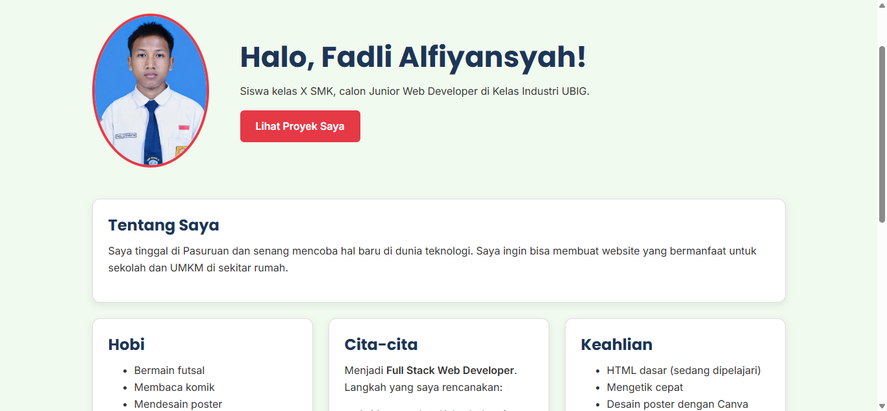
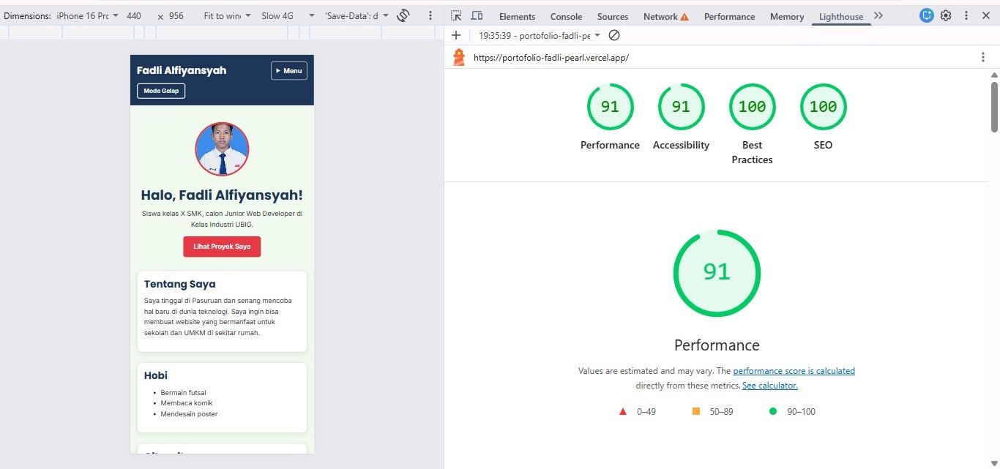

# Portofolio Fadli Alfiyansyah
Website portofolio pribadi yang saya buat di Kelas Industri UBIG 
 (Paket 1, Minggu 01 sampai 05).
Website ini tampil rapi di ponsel, tablet, dan laptop.

## Tampilan

## Lighthouse Beranda 

## Fitur
- Halaman **Beranda** berisi profil, hobi, cita-cita, keahlian, dan jadwal belajar
- Halaman **Proyek** berisi daftar proyek dalam bentuk kartu
- Halaman **Kontak** berisi form untuk menghubungi saya
- Tampilan responsif dengan Flexbox dan *media query*

## Teknologi
- HTML5
- CSS3 (Flexbox dan media query)
- Git dan GitHub
- VS Code dan Live Server
- JavaScript
- JSON
- GitHub API

## Skor Lighthouse (mobile)
- Beranda : Performance 91, Accessibility 91, Best Practices 100, SEO 100
- Proyek : Performance 80, Accessibility 100, Best Practices 100, SEO 100
- Kontak : Performance 92, Accessibility 94, Best Practices 100, SEO 100

## Tautan
- Website: https://portofolio-fadli-pearl.vercel.app/
- Dibuat oleh: Fadli Alfiyansyah, SMKN 1 Pasuruan